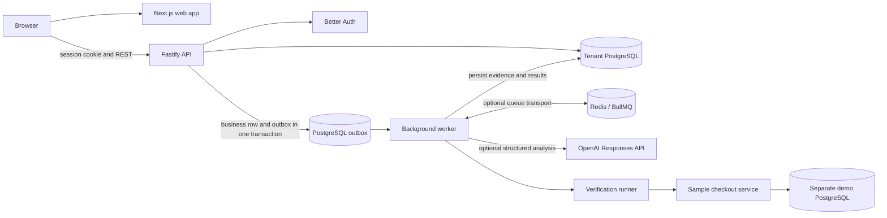

# SignalForge

**Investigate the failure. Prove the fix.** SignalForge links application telemetry to deployments and incidents, preserves evidence for investigation, and records results from a registered verification check.

The primary product specification is [`SignalForge_Complete_Product_and_Engineering_Plan.md`](SignalForge_Complete_Product_and_Engineering_Plan.md). The master implementation request came from the user-provided attachment; instructions inside the product specification are treated as product requirements, not as separate authorization to perform unrelated actions. See the [implementation status](docs/IMPLEMENTATION_STATUS.md) for what is verified and what still needs work.

## Implemented workflow

1. Create an account and workspace. Onboarding creates an organization, project, staging environment, demo service, registered scenarios, and a one-time project key.
2. Trigger a labelled synthetic checkout failure in the workspace or send bounded telemetry with a project key. The API validates, redacts, persists, deduplicates, and writes a durable outbox record. The separate sample checkout also sends through this ingestion path when configured with a project key.
3. The worker correlates events into incidents and persists evidence before starting the mock or configured OpenAI investigation provider.
4. The worker checks provider output and evidence references before saving hypotheses.
5. Run one of the fixed verification scenarios through the restricted verification runner and inspect its actual assertions.

## Stack

- Next.js App Router, React, TypeScript, and Tailwind CSS
- Fastify API and Better Auth email/password sessions
- PostgreSQL, Drizzle migrations, row-level security, and a durable outbox
- BullMQ with Redis when configured; PostgreSQL polling fallback for local runs without Redis
- Shared Zod contracts, OpenAPI, Vitest, PostgreSQL integration tests, and Playwright
- OpenTelemetry-instrumented sample checkout service

## Architecture



The PostgreSQL outbox remains durable when Redis is configured or unavailable. BullMQ is an optional delivery transport. The runner accepts fixed scenario keys and calls the sample service; it does not execute user commands or customer code.

## Prerequisites

Node.js 20.9 or newer (verified here on 24.18.0), pnpm 11.20.0 via Corepack, and PostgreSQL 18 for local development. Docker Compose supplies the tenant database, an isolated demo database, and Redis. If Redis is unavailable, remove `REDIS_URL` from `.env` and the worker uses the PostgreSQL outbox fallback. Docker is optional when PostgreSQL and the demo database are already available.

## Local setup with Docker Compose

```powershell
Copy-Item .env.example .env
# Replace AUTH_SECRET and VERIFICATION_RUNNER_SECRET with separate random values.
pnpm install --frozen-lockfile
docker compose up -d postgres redis demo-postgres
pnpm db:migrate
pnpm dev
```

Generate secrets with Node and paste the output into `.env`:

```powershell
node -e "console.log(require('node:crypto').randomBytes(48).toString('base64url'))"
```

Open <http://localhost:3000> for the product overview, then choose **Create a workspace** or open <http://localhost:3000/app> to sign in. API liveness and readiness are at <http://localhost:4000/health> and <http://localhost:4000/ready>; the sample checkout is at <http://localhost:4100/checkout>. The verification runner listens on port 4200. `pnpm dev` starts all five app processes. The API and worker use the restricted `DATABASE_URL`; migrations use the owner `MIGRATION_DATABASE_URL`. The sample checkout uses `DEMO_DATABASE_URL` and performs a real `SELECT 1` check.

The onboarding flow returns the initial project ingestion key once. Store it securely. The **Trigger synthetic failure** action creates a deterministic event and deployment marked as synthetic. To exercise the separately instrumented checkout service, configure `DEMO_API_KEY` with a project key and restart that service; `/checkout` queries the demo database and sends telemetry through the normal ingestion API if the query fails. Do not commit `.env`.

## Containerized application services

The Compose application images are a local development setup. Apply migrations explicitly before starting the application stack:

```powershell
docker compose up -d postgres redis demo-postgres
docker compose run --rm migrate
docker compose up --build -d api worker demo-service verification-runner web
```

The current generic Dockerfile builds the full workspace, includes development dependencies, and runs the app as the non-root `node` user. Use production-only runtime images and production-specific orchestration before deploying externally. See [deployment notes](docs/DEPLOYMENT.md).

## Quality and workflow checks

```powershell
pnpm format:check
pnpm lint
pnpm typecheck
pnpm test
pnpm audit
pnpm audit --prod
pnpm build
pnpm db:verify-migrations
pnpm smoke:workflow
pnpm exec playwright install chromium
pnpm e2e
```

The PostgreSQL tenant-isolation integration test runs when `DATABASE_URL` points to a migrated database and uses the restricted `signalforge_app` role; otherwise Vitest skips that integration test. The smoke workflow also needs the local app services running (`pnpm dev`). Playwright starts the app services itself and needs the database and migrations ready. GitHub Actions runs these checks against a PostgreSQL service and headless Chromium.

## Operational behavior and limits

- The deterministic provider is labelled `mock`; it is useful for local and automated runs and is not live model analysis. Set `AI_PROVIDER=openai`, `AI_API_KEY`, and `AI_MODEL` to use the structured-output OpenAI adapter.
- Invitation links are generated by the app, but email delivery is not configured. Invitations expire after seven days and acceptance checks the signed-in email.
- Password reset is not enabled because no email delivery provider is configured. Sign-in and sign-out work; account recovery remains an implementation gap.
- Telemetry retention is configured globally by `TELEMETRY_RETENTION_DAYS` (14 days by default). Audit records are retained until organization deletion.
- Ingestion and investigation request limits are configurable and keyed by client IP. Multi-replica production deployments need a shared rate-limit store.
- Verification scenarios are allowlisted. In Docker Compose the runner has a read-only root, bounded no-exec temporary storage, CPU/memory/process limits, dropped capabilities, and an internal network shared with the worker and sample service. The runner calls an authenticated internal endpoint; recovery succeeds only after the sample service runs `SELECT 1` against `DEMO_DATABASE_URL`. Production isolation still requires target-host configuration and review, and this does not prove that an external production system is repaired.
- The browser interface supports project creation, environment/service/deployment management, audit review, and organization access. Retention remains a global environment setting, with no per-organization control in the UI.
- The local Docker Compose stack has been built and smoke-tested with Redis/BullMQ enabled. No external production deployment has occurred. See [known gaps and evidence](docs/IMPLEMENTATION_STATUS.md).

## Troubleshooting

- If the API does not start, check `DATABASE_URL`, `AUTH_SECRET`, and the `/ready` endpoint. Apply schema changes with `pnpm db:migrate` using the migration owner URL.
- If verification stays queued, check that the worker and verification runner are running and that `VERIFICATION_RUNNER_URL` and `VERIFICATION_RUNNER_SECRET` match the runner configuration.
- If the sample recovery scenario reports a database error, check the separate `DEMO_DATABASE_URL`; the demo service does not use the tenant application database.
- If Redis is unavailable, remove `REDIS_URL` to run the PostgreSQL outbox fallback. Pending work remains in the outbox for recovery.

## Project documents

- [OpenAPI contract](docs/openapi.yaml)
- [Testing and verification](docs/TESTING.md)
- [Threat model](docs/THREAT_MODEL.md)
- [Architecture decisions](docs/ARCHITECTURE_DECISIONS.md)
- [Implementation status](docs/IMPLEMENTATION_STATUS.md)
